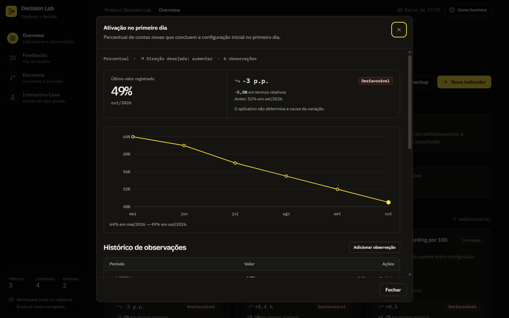
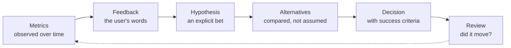
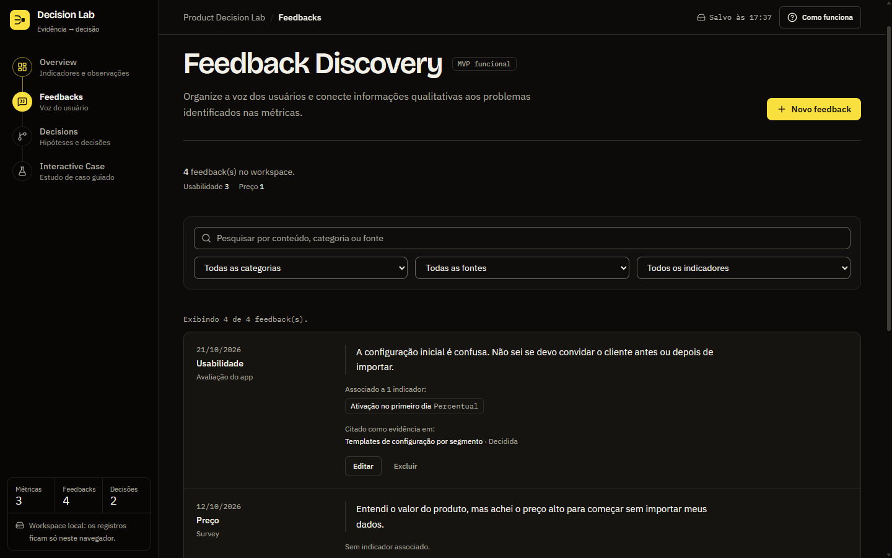
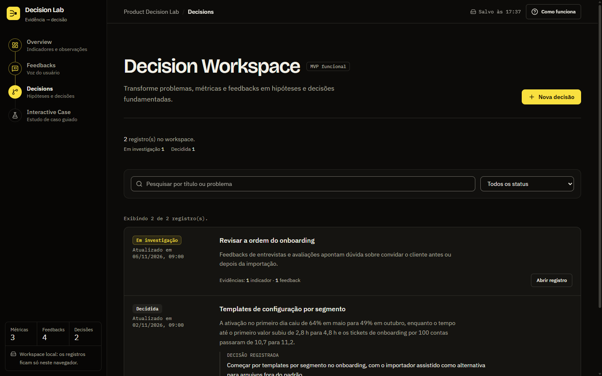
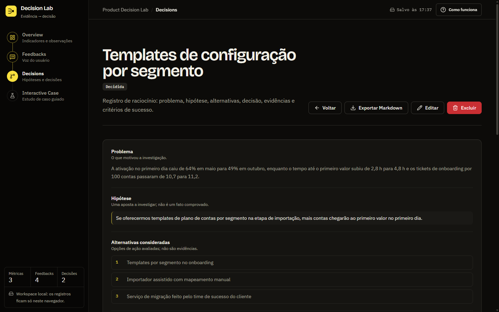
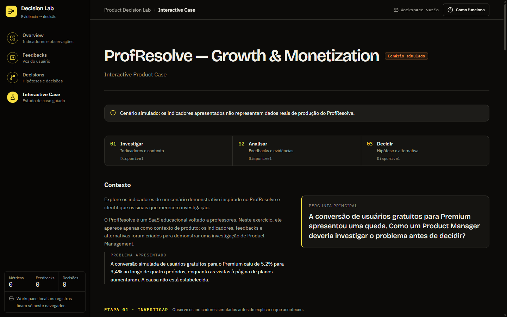

<div align="center">

# Product Decision Lab

**A local-first workspace that connects product metrics, user feedback, hypotheses, and decisions — so the reasoning behind a product bet stays visible.**

[](https://react.dev)
[](https://www.typescriptlang.org)
[](https://vite.dev)
[](https://tailwindcss.com)
[](https://vitest.dev)
[](#data-and-privacy)
[](#project-status)



</div>

---

## What it is

Most product decisions leave a trail of half-remembered metrics, scattered interview notes, and a Slack thread that ends with "let's go with option B". Product Decision Lab is a small, opinionated tool that keeps that trail in one place.

It is a **portfolio project** that demonstrates how Product Discovery, Product Analytics, and Decision Management can be practiced with explicit evidence and explicit trade-offs. Every screen is designed to show *how* a conclusion was reached — and to refuse to invent a cause that the data does not support.

- **Evidence over vibes.** Metrics and feedback are linked to the problem they inform.
- **Reasoning made explicit.** Hypotheses, alternatives, decisions, and success criteria are first-class fields.
- **No causal theatre.** The app computes variation and direction, but never claims that a metric moved *because of* something.
- **Local by design.** No backend, no accounts, no sync, no telemetry, no AI services.

## The loop



## Modules

| Module | What you can do | Why it matters |
| --- | --- | --- |
| **Product Overview** | Create, edit, and delete metrics and monthly observations; read history, trend, absolute and relative variation, and a direction-aware interpretation. | Separates what happened from why it might have happened. |
| **Feedback Discovery** | Capture, edit, filter, and search qualitative feedback; classify by category and source; attach it to metrics. | Keeps the user's voice attached to the number it explains. |
| **Decision Workspace** | Build decision records with problem, linked evidence, hypothesis, alternatives, decision, success criteria, next steps, and status; export any record as Markdown. | Produces an artifact you can revisit, share, and challenge. |
| **Interactive Product Case** | Work through a simulated ProfResolve scenario: investigate metrics, select evidence, write a hypothesis, pick an alternative, and see a summary of the reasoning. | Practices the same loop in a guided, consequence-free setting. |

A guided tour behind the **How it works** button walks through all four modules inside the app.

## Screenshots

| Feedback Discovery | Decision Workspace |
| --- | --- |
|  |  |

**Decision record** — every decision keeps its problem, hypothesis, alternatives, criteria, and evidence together.



**Interactive Product Case** — a simulated scenario, clearly labeled as such, with the same investigate → analyze → decide structure.



## Tech stack

| Layer | Choice |
| --- | --- |
| UI | React 19, TypeScript 6, Vite 8 |
| Styling | Tailwind CSS v4, Radix UI primitives (shadcn/ui pattern), Lucide icons |
| Charts | Recharts, loaded lazily per route and state |
| Routing | Hash-based router with query parameters (`#/overview?metric=<id>`) |
| State | Single `WorkspaceProvider` with pure domain operations and transactional commits |
| Persistence | `localStorage` with schema versioning, integrity validation, and Web Locks |
| Quality | Vitest, Testing Library, ESLint, `tsc -b` |

The design language is a "lab notebook" theme: near-black paper, a single highlighter-yellow accent for evidence, monospaced metadata, and locally hosted IBM Plex and Bricolage Grotesque fonts — no external font requests.

## Getting started

**Requirements:** Node.js `^20.19.0` or `>=22.12.0` (Vite 8), npm.

```bash
git clone https://github.com/rsehenth/productlabs.git
cd productlabs
npm install
npm run dev
```

Vite prints the local address. To build and preview the production bundle:

```bash
npm run build     # typecheck + production build in dist/
npm run preview   # serve the built bundle
```

## Scripts

| Command | Purpose |
| --- | --- |
| `npm run dev` | Start the Vite dev server |
| `npm run build` | Typecheck the project and build to `dist/` |
| `npm run preview` | Serve the production build locally |
| `npm test` | Run the Vitest suite once |
| `npm run test:watch` | Run Vitest in watch mode |
| `npm run typecheck` | Run `tsc -b` |
| `npm run lint` | Run ESLint |

## Data and privacy

The workspace lives in **your browser's LocalStorage**, under `product-decision-lab:workspace`. Nothing is uploaded, and there is no automatic recovery if browser data is cleared.

- Writing is **transactional** and uses **Web Locks** to detect conflicts between cooperating tabs. If Web Locks is unavailable or a lock fails, the write is refused rather than risking corruption.
- Every read and write is validated for structure and referential integrity.
- Invalid or future-version data is never silently deleted — you can export the raw payload or discard it explicitly.
- **Backups are manual JSON files.** Import validates the file, version, structure, relationships, and business rules, then **replaces the entire workspace** after confirmation. Maximum file size is 5 MiB. Backup files are not encrypted by the app.
- Records marked as simulated are kept out of the workspace; the demo dataset and the Interactive Case never write into your data.

Because storage is scoped to origin and browser profile, changing browser, profile, device, domain, protocol, or port means starting from a different workspace. Use the backup buttons to move data deliberately.

## Repository layout

```text
src/
  components/   layout and shared UI primitives
  data/         simulated demo datasets
  features/     overview, feedbacks, decisions, interactive-case, product-tour
  hooks/        workspace provider and derived state
  lib/          domain operations, analytics, routing, storage, validation, backup
  types/        domain and workspace models
  test/         test setup and helpers
assets/         screenshots used by this README
```

## Project status

**Functional MVP, validation in progress.** All four modules are implemented, including CRUD, relationships, persistence, backup, Markdown export, the guided tour, and route-level code splitting.

Last verified on **10 November 2026**:

| Area | State |
| --- | --- |
| Unit and component tests | **403 passing** in 28 files (`npm test`) |
| Typecheck, lint, production build | **Passing** (`npm run typecheck`, `npm run lint`, `npm run build`) |
| Browser smoke (Chromium, headless) | **Passed** — four routes, reloads, navigation, lazy chunks, no console errors in the observed flows |
| Functional regression (Chromium) | **Passed with limitations** — metric/feedback/decision flows, validation by status, persistence, Markdown export, storage-failure handling |
| Firefox and WebKit/Safari | **Pending** |
| Accessibility audit (keyboard, focus, screen readers) | **Pending** — no conformance claim |
| Responsiveness across target viewports | **Partially checked** — mobile navigation only |
| Real-world performance measurement | **Pending** — bundle splitting is implemented, not benchmarked |
| Hosted deployment | **Not published** |

### Next up

- Complete the integrated regression across the remaining scenarios (multi-tab conflicts, backup import/export round-trips).
- Validate Firefox and WebKit, plus keyboard, focus, and screen-reader behavior.
- Measure runtime and transfer performance instead of inferring from bundle sizes.
- Publish a hosted demo and link it here.

## Notes

- The Ledgerly dataset and the ProfResolve case are **fictional** and exist only to exercise the models. They are not real product results.
- There is no multi-user mode, authentication, or synchronization. The app intentionally stops at a single-user, local workspace.
- The Interactive Case keeps its state in the component only; it does not modify the workspace.
- Documentation for individual development stages is kept locally and is not part of the public repository.

---

<div align="center">
<sub>Built as a portfolio project about evidence-driven product work — and about showing the reasoning, not just the conclusion.</sub>
</div>
