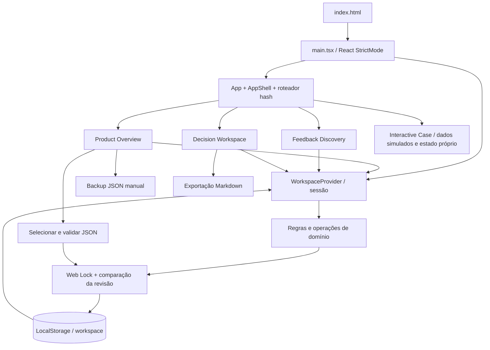

# Product Decision Lab — auditoria de prontidão para produção 4C.1

Data: 09/11/2026. Escopo: inspeção e verificações locais, sem deploy ou mudanças no produto.

## 1. Resumo executivo

A arquitetura frontend é compatível com hospedagem estática na raiz de um domínio. O build atual passou e o preview de produção abriu as quatro rotas, preservou um indicador fictício após reload e permitiu voltar no histórico. Não foi identificada dependência obrigatória de backend nas buscas e arquivos examinados. O workspace local é coerente com a proposta, desde que suas limitações sejam comunicadas. O bundle principal permanece grande e ainda não teve contribuição por biblioteca quantificada. Nenhum bloqueio técnico à preparação foi demonstrado; isto não certifica o ambiente publicado.

## 2. Classificação geral

**PASS WITH LIMITATIONS** para avançar à preparação 4C.2, não como autorização de publicação. Sem P0 demonstrado. Antes do link público, validar hospedagem real, HTTPS, navegadores previstos e comunicação da persistência e perda de dados. As prioridades abaixo refletem riscos e trabalho de preparação, não defeitos presumidos.

## 3. Baseline e quality gates

| Verificação atual | Resultado |
|---|---|
| `npm test` | 392 testes, 26 arquivos, aprovados |
| `npm run lint` | aprovado |
| `npm run build -- --outDir <temp>` | aprovado; inclui `tsc -b` (typecheck); aviso de chunk > 500 kB |
| Preview do build temporário | smoke em Chromium isolado, detalhado na seção 18 |
| Ambiente | Node 26.13.0, npm 11.20.0, Vite 8.3.6 instalado |

A 4B.6b.4 registrou 12/12 verificações adicionais em Chromium e classificação APPROVED WITH LIMITATIONS; esse roteiro não foi reexecutado nesta auditoria. Foram consultados os relatórios 4B6B-4, 4B6B, 4B6A, 4B5B e 4B4C; resultados históricos não são novos testes. Não há metadados Git neste diretório: não é possível comprovar diff ou estado anterior por Git. O build usou diretório temporário fora do projeto; `tsc -b` pode atualizar cache incremental em `node_modules/.tmp`.

## 4. Arquitetura atual

`index.html` → `src/main.tsx` monta React em StrictMode, envolve `App` em `WorkspaceProvider`. `src/App.tsx` escolhe as quatro páginas a partir de `src/lib/routing.ts`, dentro de `components/layout/app-shell.tsx`. `features/` contém overview, feedbacks, decisions e interactive-case; `components/ui` e `components/layout` reúnem componentes compartilhados; `types/` define modelos; `data/` contém dados demonstrativos; `lib/domain/operations.ts` e `decision-rules.ts` concentram operações e regras. React state gerencia estado de interface; provider, `useSyncExternalStore` e sessão mantêm o workspace. A sessão valida e persiste via `lib/storage`, não há store externo do produto. Radix fornece diálogos; Recharts, gráficos; Lucide, ícones; Tailwind e CSS, apresentação.

Erros de leitura, validação, versão, gravação e conflito são representados por estados/resultados e banners (`workspace-banners.tsx`, `storage-alert.tsx`, `stale-notice.tsx`). Gravações são assíncronas pelo lock; leitura de arquivo usa promessas e identidade de seleção para descartar resultados antigos (`backup-selection.ts`). Não foi constatado um error boundary global em `App.tsx`; não se afirma cobertura total de exceções.

## 5. Diagrama Mermaid

O Case é carregado estaticamente no bundle, mas seus dados e estado interativo são independentes do workspace; esta independência é funcional, não isolamento de código em outro processo.

## 6. Auditoria do Vite e build

`vite.config.ts` define plugins React e Tailwind e alias `@`; não define `base`, target, minificação, sourcemap ou saída. A base padrão é `/`, adequada à raiz; assets de CSS e favicon também são absolutos, portanto subdiretório exige revisão adicional. O build usa padrões de produção, minificado, sem mapas emitidos; `tsconfig.app.json` tem target ES2023 para TypeScript, distinto do target final do Vite. A documentação da linha Vite 8 descreve `baseline-widely-available` para build e source maps desativados por padrão ([build options](https://github.com/vitejs/vite/blob/v8.3.5/docs/config/build-options.md)). Não se inferem polyfills a partir desse target.

O comando normal é `npm run build`, com saída padrão `dist`; nesta execução a saída foi redirecionada para diretório temporário. HTML gerado aponta para JS/CSS com hash em `/assets/`; fontes e favicon estão na raiz. O preview confirmou recursos requisitados no percurso, não todas as combinações possíveis.

## 7. Compatibilidade com Cloudflare Pages

Configuração proposta para Git build: comando `npm run build`, diretório `dist`, Node compatível explicitamente selecionado e sem variáveis de aplicação identificadas. A saída tem HTML, CSS, JS, favicon e fontes, sem funções de servidor. Não foram encontrados `_redirects`, `_headers` ou configuração Wrangler no projeto inspecionado. Hash routing não exige regra de fallback por rota; a documentação do Pages descreve fallback SPA para caminhos inexistentes quando não há `404.html` na raiz ([serving Pages](https://developers.cloudflare.com/pages/configuration/serving-pages/)). Não depende desse fallback para `/#/...`.

Domínio próprio é possível mediante configuração de domínio/DNS na conta Cloudflare e HTTPS; não foi configurado nem testado. Confirmar versão efetiva de Node e provisionamento do domínio na publicação. `_headers` não é requisito para servir esta aplicação; política de headers pode ser avaliada separadamente. Vite preview local não comprova comportamento da CDN, headers ou configuração real de Pages.

## 8. Auditoria do roteamento

Não usa React Router ou HashRouter: `routing.ts` interpreta `window.location.hash`, escuta `hashchange` e altera o fragmento. Rotas válidas: `#/overview`, `#/feedbacks`, `#/decisions`, `#/interactive-case`; parâmetros ficam após `?` no fragmento; hash inválido cai em overview. Fragmentos não chegam ao servidor, logo um reload e abertura direta na raiz com hash não exigem rewrite específico. Testadas abertura direta e reload das quatro rotas e voltar entre feedbacks e decisions; não foi feita varredura exaustiva de todos os links internos e parâmetros.

## 9. Auditoria de assets

`public/` contém `favicon.svg` e quatro fontes WOFF2; CSS usa `font-display: swap` e URLs `/fonts/...`. Ícones são componentes Lucide; gráficos usam Recharts. Não há imagens externas de produto identificadas nem URLs externas de runtime no código pesquisado. HTML, JS, CSS, favicon e fontes foram servidos no smoke; chunks dinâmicos aparecem na saída. Requisições adicionais de `kaspersky-labs.com` observadas no ambiente de teste são injeção local de software de segurança, não dependência encontrada no projeto. Não se verificou subcaminho ou política de rede da implantação final.

## 10. Persistência local

Chave de dados identificada: `product-decision-lab:workspace` (`src/lib/storage/schema.ts`); lock tem nome separado e não é chave de armazenamento. O envelope JSON persistido contém `schemaVersion: 1`, `savedAt` e `data` com arrays metrics, observations, feedbacks e decisions. Leitura inicial em `workspace-session.ts` usa `loadWorkspace`: ausência gera vazio; JSON, schema e integridade são validados; versão futura ou dados inválidos bloqueiam operações usuais e permitem tratamento explícito; falhas de acesso geram estado unavailable. Escrita valida estrutura e integridade, compara revisão e executa `setItem`, tratando cota/permissão. Reload lê novamente o envelope.

Dados pertencem à origem e ao perfil do navegador; outro navegador, dispositivo, porta, protocolo ou domínio não recebe sincronização. Limpar dados do site, perfil privado encerrado ou perda do perfil pode apagá-los; não existe recuperação automática nem backup automático. Quotas dependem do navegador e ambiente; não é seguro prometer um tamanho universal. JSON é exportado manualmente (`schemaVersion`, `exportedAt`, `data`); Markdown exporta decisões via `lib/markdown.ts` e download local. Importação limita arquivo a 5 MiB, valida versão, estrutura, integridade, registros simulados e regras de decisão; mostra resumo e, após confirmação, substitui todo o workspace, sem mescla. Alguns backups legados incompatíveis são recusados com orientação; não há regularização automática. Backup não é criptografado pela aplicação: tratar o arquivo conforme a sensibilidade dos dados.

## 11. Web Locks

`write-lock.ts` solicita lock exclusivo `product-decision-lab:workspace-write` antes de operação, substituição ou descarte. Dentro do lock, a sessão compara a string bruta esperada com o valor atual; divergência recusa gravação e marca stale. Evento `storage` antecipa aviso entre abas; o usuário pode atualizar. Sem API disponível, ou se pedido de lock falha, a gravação é recusada e uma mensagem orienta navegador atual em HTTPS ou localhost. A garantia depende de participantes cooperarem com o mesmo protocolo; não protege contra scripts externos que ignorem o lock. Testes unitários passaram; nesta etapa não se reexecutou corrida real entre abas nem cobertura entre navegadores.

## 12. Dependências

`package-lock.json` presente; scripts: `dev`, `build`, `typecheck`, `lint`, `test`, `test:watch`, `preview`. Produção declarada: React, React DOM, Recharts, Radix Dialog/Slot, Lucide, class-variance-authority, clsx e tailwind-merge. Desenvolvimento: Vite, plugin React, Tailwind/Vite, TypeScript, ESLint, Vitest e tipos. As versões resolvidas observadas incluem React/React DOM 19.3.1 e Recharts 3.10.1; `npm ls` mostrou React e React DOM deduplicados nessa árvore. Isso não prova ausência de outras duplicações ou código desnecessário. `package.json` não declara `engines`; Vite instalado declara Node `^20.19.0 || >=22.12.0`, requisito da ferramenta, não garantia do conjunto inteiro. Fixar e testar uma versão compatível no Pages; Node 26 foi o ambiente testado, não uma recomendação de versão de produção.

Não houve instalação, atualização, auditoria de vulnerabilidades ou análise completa de licenças. Dependências e lock não foram intencionalmente alterados; sem Git, não há verificação por diff.

## 13. Variáveis de ambiente

Busca em fonte e config por `import.meta.env`, `process.env`, URLs e chamadas `fetch` não encontrou uso de variáveis ou endpoints de aplicação. Nenhum arquivo `.env*` na raiz foi listado; conteúdo de credenciais não foi aberto. Classificação para o código examinado: nenhuma variável de aplicação identificada como obrigatória no build, runtime ou opcional. Variáveis providas pelo ambiente de build para selecionar Node são configuração da plataforma, não segredo nem dependência do produto. Busca estática não prova ausência absoluta em dependências transitivas ou no ambiente hospedado.

## 14. Performance e bundle

| Artefato | Bruto | gzip (Vite) |
|---|---:|---:|
| JS principal | 829,53 kB | 241,53 kB |
| CSS | 44,17 kB | 8,33 kB |
| Gráfico | 2,51 kB | 1,15 kB |
| Prévia | 11,33 kB | 3,97 kB |
| HTML | 0,70 kB | 0,42 kB |

Vite transformou 2.570 módulos e avisou sobre chunk > 500 kB; isso não mede tempo de carregamento nem é prova de bloqueio. `App.tsx` importa as quatro páginas estaticamente; Interactive Case importa gráfico Recharts, e gráficos da prévia e detalhe também usam Recharts. Prévia e detalhe já usam `lazy`; a prévia é renderizada imediatamente quando workspace está vazio, então seu chunk é solicitado no primeiro acesso. A presença de gráfico em chunk de 2,51 kB **não** equivale ao peso total do Recharts: dependências podem estar no chunk principal. Não foi produzido mapa de composição, logo contribuição exata de Recharts ou ranking de bibliotecas é desconhecida. A árvore consultada mostra React deduplicado, não comprova eliminação de toda duplicação.

Prioridade: medir composição e waterfall/CPU em rede e dispositivo representativos; então comparar divisão por rota, especialmente Interactive Case e gráficos compartilhados, sem assumir redução equivalente ao tamanho da biblioteca. Evitar alterar imports ou limites de aviso antes de medir benefício. Não há evidência de que otimização seja obrigatória para publicar, mas é uma oportunidade de preparação.

## 15. Experiência de primeiro acesso

Com armazenamento novo, overview mostra workspace vazio, chamada para criar indicador, aviso de dados somente no navegador e prévia explicitamente fictícia e separada. Outras páginas descrevem seus objetivos e oferecem criação; Case é identificado como cenário simulado. A clareza desses textos foi observada, mas facilidade de compreensão por visitantes não foi testada com pessoas. Para 4C.4, avaliar comunicação persistente de backup manual, ausência de sincronização e perda ao limpar dados, inclusive quando workspace não está vazio; avaliar orientação transversal sem pressupor necessidade de onboarding.

## 16. Limitações arquiteturais

**Intencionais:** sem backend, autenticação, multiusuário ou sincronização remota; dados e prévia locais/simulados. Não exigem conversão para SaaS.

**Técnicas:** dependência de Web Locks/contexto seguro para gravação; quota e disponibilidade variáveis; backup manual e substituição integral; ausência de recuperação automática; arquivos Markdown interpolam texto e sintaxe pode ser interpretada pelo leitor (limitação já documentada em 4B6B-4); target de sintaxe não garante APIs presentes.

**Preparação de publicação:** validar domínio/HTTPS e ambiente real, compatibilidade dos navegadores pretendidos e comunicação de perda, executar verificações finais de acessibilidade e desempenho. Relatórios anteriores registram cobertura amostral de contraste e ausência de testes abrangentes com leitor de tela e dispositivos físicos; não se conclui conformidade WCAG.

## 17. Achados classificados

| ID | Prioridade | Local e evidência | Impacto | Recomendação / etapa |
|---|---|---|---|---|
| 4C1-01 | P1 | `write-lock.ts`: gravação recusada sem Web Locks; preview apenas Chromium localhost | visitantes em contexto/navegador não suportado não conseguem salvar | Em 4C.2/4C.5 validar HTTPS e navegadores alvo e comunicar suporte; não remover proteção |
| 4C1-02 | P1 | `overview-page.tsx`, `backup.ts`: aviso inicial local, backups manuais | perda irrecuperável pode surpreender visitante após limpeza ou troca de origem | Em 4C.4 assegurar transparência sobre perda, sincronização e backup antes do link público |
| 4C1-03 | P2 | `App.tsx`, build: imports estáticos e 829,53 kB JS principal | possível custo de rede e execução, ainda não medido em condições reais | Em 4C.3 medir composição e experiência; avaliar divisão por rota caso benefício demonstrado |
| 4C1-04 | P2 | `index.html`, `index.css`, `vite.config.ts`: caminhos absolutos e base padrão `/` | implantação sob subdiretório pode falhar | Em 4C.2 publicar na raiz ou avaliar base e caminhos se escopo mudar |
| 4C1-05 | P2 | `package.json` sem engines; Vite instalado exige Node compatível | versão da plataforma pode impedir build | Em 4C.2 selecionar e verificar Node compatível no ambiente de hospedagem |
| 4C1-06 | P2 | `docs/VISUAL-REFINEMENT-4B6B-4.md`: cobertura de acessibilidade e navegadores limitada | problemas podem persistir fora dos cenários exercitados | Em 4C.5 validar navegadores alvo, teclado e acessibilidade prioritária |
| 4C1-07 | P3 | `lib/markdown.ts`, histórico 4B6B-4: interpolação de sintaxe | conteúdo pode ser renderizado como marcação | Em etapa posterior avaliar contrato e escape conforme uso, sem modificar agora |
| 4C1-08 | INFO | `schema.ts`, `backup.ts`: localStorage e restauração integral | comportamento intencional, sem sincronização | Manter proposta e documentar claramente em 4C.4 |

Nenhum P0 demonstrado. P1 indica pré-requisito de lançamento e validação, não prova de defeito funcional atual.

## 18. Smoke test de produção

Build real com saída temporária e `vite preview --outDir <temp> --host 127.0.0.1 --port 4178 --strictPort`; Chromium automatizado com novos contextos isolados e dados fictícios. Aberto `/#/overview`, `/#/feedbacks`, `/#/decisions`, `/#/interactive-case`, cada um recarregado e seu título confirmado. Fluxo adicional criou indicador, confirmou um registro serializado e presença após reload; fechou detalhe, navegou por links e voltou para Feedback Discovery. Não houve erros de console nível error, exceções de página ou respostas HTTP >=400 observadas nesses percursos. JS, CSS, fontes e favicon locais foram requisitados; a prévia carregou no primeiro contexto. Uma tentativa inicial de clicar na navegação falhou por overlay do detalhe aberto após criação; repetição fechando o diálogo passou. Não foi teste de backup/importação, concorrência, todas as rotas parametrizadas, navegadores adicionais ou rede de produção.

## 19. Recomendações para 4C.2–4C.5

- **4C.2:** preparar Pages com build `npm run build`, saída `dist`, versão Node compatível e domínio raiz com HTTPS; testar deploy de prévia e URLs reais antes da publicação.
- **4C.3:** medir composição do bundle e desempenho realista; avaliar lazy por rota somente com evidência e verificar regressões.
- **4C.4:** comunicar aplicação demonstrativa, dados fictícios, armazenamento por origem/dispositivo, perda, backup manual e restauração integral; testar entendimento do visitante.
- **4C.5:** validar smoke em ambiente hospedado e navegadores alvo, Web Locks, navegação, backup/restauração com dados fictícios, acessibilidade prioritária e recursos HTTP; conferir headers e domínio.

## 20. Decisão final

1. Publicação estática: **sim**, para a raiz do domínio, conforme build e preview locais.
2. Cloudflare Pages: **compatível por arquitetura e documentação**, ainda sem deploy comprovado.
3. Backend: **nenhum identificado** no código e buscas examinados; não é uma prova sobre todo código transitivo.
4. Persistência: **adequada à proposta**, com limites de origem, Web Locks e perda comunicados.
5. Build/rotas: **passaram nos cenários locais**; aviso de tamanho e limitação de subdiretório permanecem.
6. Bundle: **não há evidência de otimização obrigatória**; medir antes de decidir.
7. Hospedagem: configurar comando, saída, Node compatível e HTTPS/domínio; nenhum rewrite específico para hashes ou variável de aplicação identificada.
8. Bloqueantes: **nenhum P0 demonstrado**; P1 são pré-requisitos a tratar antes de publicar.
9. Próximas correções e verificações: itens 4C1-01 a 06 conforme etapas acima.
10. Iniciar 4C.2: **sim**, sem iniciar automaticamente nem considerar a aplicação já publicada.

Limites: não houve deploy, auditoria de vulnerabilidades, análise quantitativa por dependência, testes de desempenho em rede lenta, navegadores adicionais ou confirmação por usuário. Somente cenários descritos foram comprovados; compatibilidade com Pages e ausência de dependências são inferências apoiadas em documentação e inspeção.

O diretório temporário do build, C:\Users\sehen\AppData\Local\Temp\pdl-audit-4c1-dist, permaneceu no disco: a política de execução rejeitou sua remoção recursiva. O preview foi encerrado.
